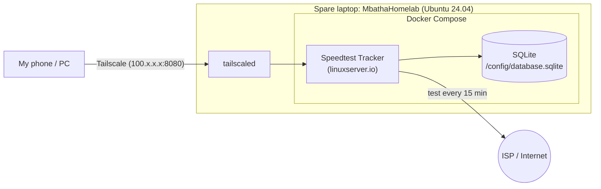

# Homelab Speedtest Tracker

A self-hosted ISP speed monitor on an old laptop, running a test every 15 minutes and reachable only over my Tailscale tailnet.

## Why I built this

I live in a rural area and my home mobile connection is weak, usually about 1 Mbps or less, and sometimes it drops to zero. I wanted real data on how my ISP performs over time, not just a feeling. I also wanted hands-on practice with Linux, Docker and networking while studying for the CCNA.

## Architecture



The dashboard is not exposed to the internet. I reach it only through Tailscale.

## Stack

| Part | Choice |
|---|---|
| Hardware | Old spare laptop |
| OS | Ubuntu 24.04 LTS "noble" |
| Containers | Docker + Docker Compose |
| App | [linuxserver/speedtest-tracker](https://docs.linuxserver.io/images/docker-speedtest-tracker/) |
| Database | SQLite |
| Remote access | Tailscale (apt package from pkgs.tailscale.com) |
| Schedule | `*/15 * * * *` (every 15 minutes) |

## Setup

1. **Install Tailscale** from the official repo (pkgs.tailscale.com), then:
   ```bash
   sudo systemctl enable --now tailscaled
   sudo tailscale up
   tailscale ip -4        # note your 100.x.x.x address
   ```
2. **Create the project folder** and copy [`docker-compose.yml`](docker-compose.yml) into it.
3. **Generate an app key** and paste it into `APP_KEY`:
   ```bash
   echo "base64:$(openssl rand -base64 32)"
   ```
4. **Set `APP_URL`** to `http://<tailscale-ip>:8080`.
5. **Validate and start:**
   ```bash
   docker compose config --quiet
   docker compose up -d
   docker compose logs -f speedtest-tracker
   ```
6. **Open** `http://<tailscale-ip>:8080` from a device on the tailnet and **change the default admin credentials on first login** (see the linuxserver.io docs; I don't list them here).

## Troubleshooting log (28 Oct 2026)

| # | Symptom | Root cause | Fix |
|---|---|---|---|
| 1 | `apt update`: "Target ... configured multiple times" | VirtualBox repo defined in two `.list` files | Removed the duplicate file |
| 2 | `NO_PUBKEY A2F683C52980AECF` / `7198F4B714ABFC68` | VirtualBox and Jenkins signing keys missing | Re-imported keys to `/etc/apt/keyrings`, used `signed-by` |
| 3 | `sudo tailscale`: command not found | Tailscale not installed yet | Installed from pkgs.tailscale.com |
| 4 | `systemctl enable --now tailscaled`: "Unit file does not exist" | Wrong assumption about the unit location | Found it with `dpkg -L tailscale` |
| 5 | tailscaled crash loop, "TUN device tailscale0 is busy" | Snap and apt installs of Tailscale fighting | Removed the snap; one daemon only |
| 6 | Old exited containers in `docker ps -a` | Leftovers from earlier labs | Housekeeping |
| 7 | Compose: `environment.[6]: unexpected type map`, YAML end-of-stream error | Mixed list/map syntax, bad quoting, stray space | Consistent `- KEY=value` list |
| 8 | App ran but `APP_KEY` was the placeholder | Key never generated | Generated key, `--force-recreate` |
| 9 | Login page reached | Default admin credentials | Changed on first login |

### 1. Duplicate VirtualBox repo
- **Symptom:** `sudo apt update` warned `Target ... is configured multiple times`.
- **Diagnosis:**
  ```bash
  ls /etc/apt/sources.list.d/
  grep -r virtualbox /etc/apt/sources.list.d/
  ```
  The same repo was in `archive_uri-...virtualbox...noble.list` and `virtualbox.list`.
- **Fix:** Removed one of the two files and ran `sudo apt update` again.
- **Lesson:** Repo files pile up quickly. Check `sources.list.d` before adding another one.

### 2. Missing GPG keys (VirtualBox and Jenkins)
- **Symptom:** `NO_PUBKEY A2F683C52980AECF` (VirtualBox) and `NO_PUBKEY 7198F4B714ABFC68` (Jenkins). apt disabled both repos because they could not be verified.
- **Fix (standard approach):** Download each vendor's current signing key into `/etc/apt/keyrings/` and reference it in the repo line:
  ```bash
  sudo install -d -m 0755 /etc/apt/keyrings
  # download the vendor key, dearmor if needed, save as /etc/apt/keyrings/<vendor>.gpg
  # deb [signed-by=/etc/apt/keyrings/<vendor>.gpg] <repo-url> noble <component>
  ```
- **Lesson:** `apt-key` is deprecated. Per-repo keyrings with `signed-by` are cleaner and safer.

### 3. `tailscale: command not found`
- **Symptom:** `sudo tailscale up` returned `command not found`.
- **Fix:** Installed Tailscale from the official repo at pkgs.tailscale.com.
- **Lesson:** Confirm a tool is installed (`which`, `dpkg -l`) before debugging it.

### 4. tailscaled unit file "does not exist"
- **Symptom:** `systemctl enable --now tailscaled` said `Unit file does not exist`.
- **Diagnosis:**
  ```bash
  dpkg -L tailscale | grep service
  # /lib/systemd/system/tailscaled.service
  sudo systemctl daemon-reload
  ```
- **Fix:** With the unit path confirmed and systemd reloaded, the service could be enabled.
- **Lesson:** `dpkg -L` shows exactly what a package installed and where.

### 5. tailscaled crash loop (snap vs apt)
- **Symptom:** `systemctl status tailscaled` showed restart counter 178 and `Start request repeated too quickly`.
- **Diagnosis:**
  ```bash
  journalctl -u tailscaled --no-pager -n 50
  #   TUN device tailscale0 is busy; another process probably still has it open
  #   tstun.New("tailscale0"): device or resource busy
  #   DNS lookups to 127.0.0.53 failing: server misbehaving
  snap list                  # tailscale 1.102.3 (snap)
  dpkg -l tailscale          # tailscale 1.104.4 (apt)
  sudo lsof -n /dev/net/tun  # shows which process holds the TUN device
  ```
  The CLI was also talking to the snap's socket (`/var/snap/tailscale/common/socket/tailscaled.sock`). Two Tailscale installs were competing for `tailscale0`.
- **Fix:**
  ```bash
  sudo snap remove tailscale
  sudo systemctl restart tailscaled
  tailscale status
  ```
  After that the node showed as connected to my tailnet with a `100.x.x.x` address, through the Johannesburg DERP relay.
- **Lesson:** Use one package manager per service. Mixing snap and apt for the same daemon causes hard-to-read conflicts.

### 6. Old containers
`docker ps -a` listed exited containers from earlier labs (nginx, a bind9 DNS server, a website and a GenAI app). They were not related to this problem. I just cleaned them up.

### 7. Docker Compose YAML errors
- **Symptoms:**
  - `services.speedtest-tracker.environment.[6]: unexpected type map`
  - `yaml: line 15: found unexpected end of stream`
- **Diagnosis:** I had mixed list style (`- KEY=value`) with one map-style line (`SPEEDTEST_SCHEDULE: "..."`), plus an unclosed quote/indentation problem, and `TZ= Africa/Johannesburg` had a stray space.
- **Fix:** Used `- KEY=value` for every variable, fixed the quoting, and validated:
  ```bash
  docker compose config --quiet   # no output = valid
  ```
- **Lesson:** Choose one YAML style per block and validate before running `up`.

### 8. APP_KEY still the placeholder
- **Symptom:** The container started and the logs and migrations looked fine, but the app key was still the placeholder.
- **Diagnosis:**
  ```bash
  docker exec speedtest-tracker php -r 'echo getenv("APP_KEY"), PHP_EOL;'
  docker exec speedtest-tracker find / -name "database.sqlite" 2>/dev/null   # /config/database.sqlite
  docker exec speedtest-tracker php /app/www/artisan migrate:status
  ```
- **Fix:**
  ```bash
  echo "base64:$(openssl rand -base64 32)"   # paste into APP_KEY
  docker compose up -d --force-recreate
  ```
- **Lesson:** "Running" does not mean "configured correctly". Check the secrets and config inside the container.

### 9. First login
I reached the login page over Tailscale. The image ships with default admin credentials, and **they must be changed on first login**. I don't publish them here.

## Results

> **TODO:** Charts will be added after a week of data (download, upload, ping and outages over time).

## Skills demonstrated

- Linux service management (systemd units, `systemctl`)
- Log-based troubleshooting with `journalctl`
- apt repositories and GPG key management (`signed-by`, keyrings)
- Docker and Docker Compose
- YAML syntax and validation
- VPN overlay networking (Tailscale, WireGuard-based, DERP relays)
- DNS troubleshooting (systemd-resolved at 127.0.0.53)

## Next steps

- [ ] Alerts (e.g. email or Telegram) when speed falls below a set threshold
- [ ] Export metrics to Prometheus and build Grafana dashboards
- [ ] Add results charts and a short write-up of what the data shows about my ISP

## About

Built by **Innocent (Nkosiyethu) Mbatha** ([@Nkosiyethu95](https://github.com/Nkosiyethu95)), an aspiring network technician and CCNA candidate with Linux Essentials certification.
